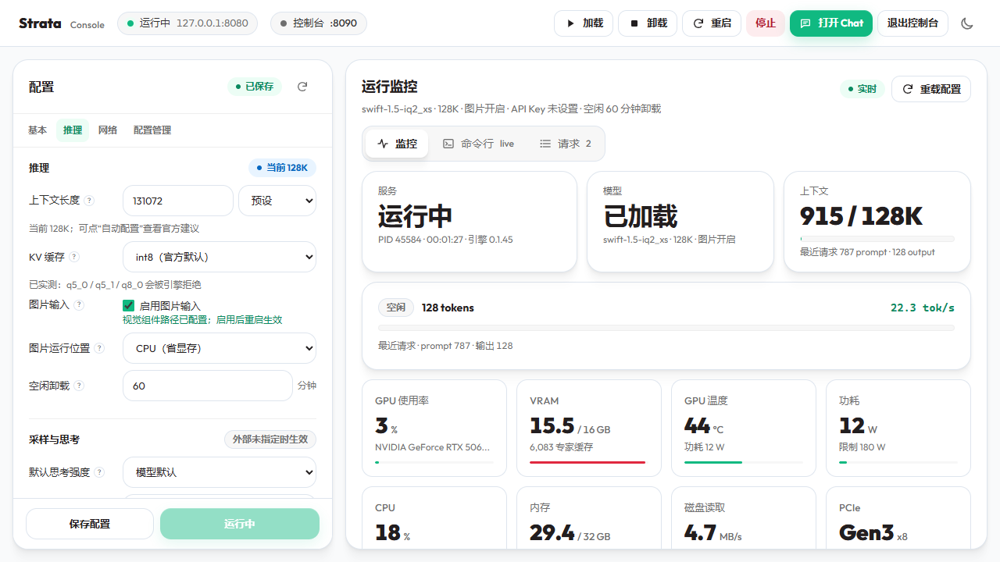
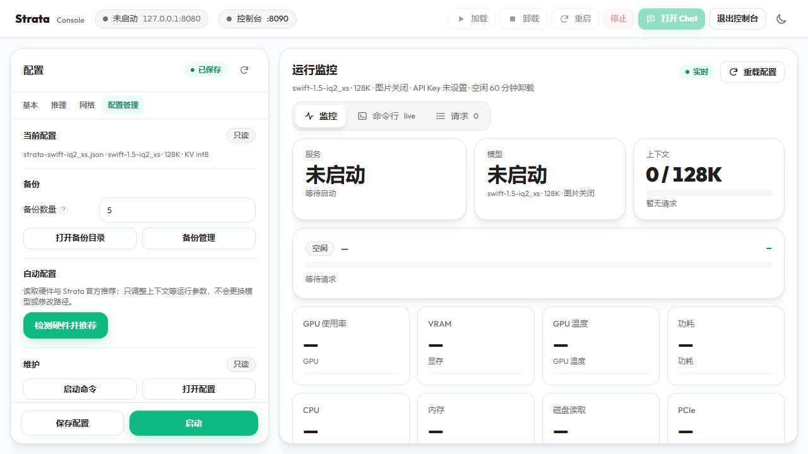
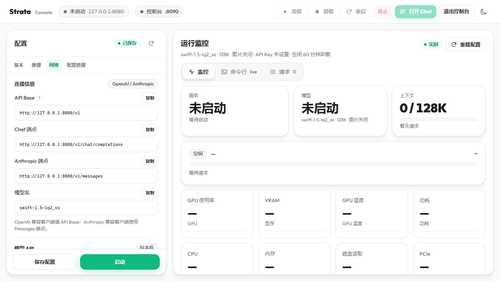

# Strata Console

一个轻量的 Windows 本地 Web 控制台，用于启动、配置和监控 **Strata** 模型服务。界面沿用 Strata 官方网页的视觉语言，后台是原生 C++ 服务，不依赖 Electron 或 WebView。


**下载：** [Latest Release](https://github.com/shujingjing/strata-console/releases/latest)



## 为什么用它

Strata 的启动参数很多，手动改 JSON、找日志、查显存状态容易出错。Strata Console 把这些操作集中到一个本地页面里：

- **图形化配置**：模型路径、上下文、KV、图片输入、采样、GPU、缓存、网络、API Key、CORS 都可以在界面里改。
- **自动重启**：服务中断后按启动参数自动恢复，默认以 `--lazy` 重启，模型等首个请求再加载。
- **实时监控**：GPU、VRAM、温度、功耗、CPU、RAM、磁盘、PCIe、当前请求、最近请求和日志。
- **自动配置**：读取 Strata 自己的硬件检测和推荐规则，给出上下文等建议。
- **官方风格**：与 Strata 的 Chat / Monitor 页面一致的卡片、字体、颜色，支持浅色和深色主题。
- **轻量**：后台常驻约 13 MB 内存，不占显存，不使用浏览器内核做桌面壳。

## 核心特性

### 图形化配置

- 自动读取 Strata 的 `strata-*.json`，模型、Pack、Tokenizer、引擎路径自动填充。
- 模型/Pack/Tokenizer 可手动修改，启动前提示兼容性风险。
- 上下文、KV、图片、采样、思考强度、低内存模式、GPU、投机解码、Prefill 分块、Expert Cache 等参数可视化。
- 参数名旁有 `?`，悬停显示说明、默认值和影响。
- 配置按 **基本 / 推理 / 网络 / 配置管理** 分页，高级项折叠。

### 进程与稳定性

- 启动、停止、重启、加载、卸载。
- 中断后自动重启（默认开启），使用上次启动参数。
- 自动重启默认附加 `--lazy`，API 先恢复，模型等首个请求再加载。
- 默认空闲 60 分钟后卸载模型，界面按分钟设置。
- 默认保留 1024 MiB VRAM，降低显存不足导致的崩溃风险。
- 停止时先尝试 `/v1/unload`，再终止进程树。

### 实时监控

- 官方 Monitor 的关键指标：GPU 使用率、VRAM、温度、功耗、CPU、RAM、磁盘、PCIe。
- 当前请求状态、预填/解码速度、上下文占用、专家缓存。
- 最近请求表（元数据，不保留提示词）。
- 命令行 Tab 实时跟随 server/engine 日志。
- 请求 Tab 显示 `/metrics` 元数据；开启 `api_monitor` 后可打开官方 `/api-monitor` 查看请求内容。

### 连接与安全

- 模型 API 默认 `http://127.0.0.1:8080/v1`，兼容 OpenAI 风格客户端。
- 连接信息一键复制：API Base、Chat Completions、Anthropic Messages、模型名。
- API Key 生成格式为 `sk-strata-*`，界面显示前缀掩码，可多次复制。
- 局域网访问默认关闭；CORS 默认关闭，可独立配置，便于反向代理或隧道。
- 控制台默认只监听 `127.0.0.1:8090`，不自动打开 Strata 的网页。

### 图片输入

- 图片开关保留；支持 CPU / GPU 编码器选择。
- 可配置视觉最大 tokens（默认 768）和 CPU 线程数（默认 8）。
- CPU 编码不占显存，适合显存紧张的长上下文配置；GPU 编码更快，但需要 CUDA 版 `strata-vision`。

### 备份与自动配置

- 每次保存前生成带时间戳的备份，默认保留 5 个，可恢复。
- 自动配置调用 Strata 的硬件检测和推荐规则，只调整运行参数，不更换模型或路径。

## 界面截图

| 配置管理 | 网络 / API |
|---|---|
|  |  |

## 快速开始

### 环境

- Windows 10/11
- 已安装 Strata，并且至少有一个可用的 `strata-*.json` 配置和模型
- 如果使用图片输入：需要 `strata-vision.exe` 和对应的 mmproj（发布包不包含编码器）

### 运行

1. 从 [Releases](https://github.com/shujingjing/strata-console/releases/latest) 下载 `strata-console-v*-win64.zip`。
2. 解压到任意目录。
3. 双击 `strata-console.exe`。
4. 浏览器打开：

   ```text
   http://127.0.0.1:8090/
   ```

5. 在“基本 / 推理 / 网络”里确认配置，点击“启动”。
6. 模型就绪后，点右上角 **打开 Chat** 进入 Strata 的聊天页面。

控制台会从 `%APPDATA%\Strata\settings.json`、启动器同级的 `Strata` 目录或用户目录下的 `Strata` 目录查找安装。如果找不到，请把 `strata-console.exe` 放到 Strata 目录旁边，或确保 Strata 的安装记录存在。

### 停止

- 在控制台点“停止”只停止模型服务。
- 顶部“退出控制台”会退出 8090 后台服务；可以选择模型继续运行或一并停止。
- 也可以使用 `stop-console.bat`。

## 配置说明

### 采样与思考

Temperature、Top P、Top K、Seed、默认思考强度写入运行配置，作为**外部调用未指定时的默认值**。如果客户端在请求中显式指定这些参数，以请求值为准。

`Max Tokens` 是客户端未指定输出上限时的默认值；`Fit Max Tokens` 开启后，如果 prompt + max_tokens 超出上下文，会自动缩短输出而不是拒绝请求。

### KV 缓存

支持：

```text
fp16 | int8 | q4_0 | k8v4
```

`Q5_0` / `Q5_1` 是专家权重格式，不是 KV 缓存类型；当前引擎不接受它们作为 `--kv`。

### 自动重启

- 默认开启。
- 使用上次启动的参数快照重启。
- 默认附加 `--lazy`，避免重启后立即占用显存。
- 连续失败会退避；超过限制后暂停并显示日志。

### 空闲卸载

- 默认 60 分钟。
- `0` 表示不卸载。
- 卸载后 API 仍在线，下一次请求重新加载模型。

## 从源码构建

需要：

- Visual Studio 2022 Build Tools（Desktop development with C++）
- Windows SDK

```powershell
powershell -ExecutionPolicy Bypass -File .\build.ps1
powershell -ExecutionPolicy Bypass -File .\package.ps1 -Version 0.1.2
```

构建脚本通过 `vswhere` 查找 Visual Studio，也支持 `STRATA_VCVARS` 指定 `vcvars64.bat`。运行时包会生成在 `dist/`。

## 安全边界

- 控制台默认只绑定 `127.0.0.1:8090`，没有管理员登录页。
- 不要直接把 8090 暴露到公网；需要远程访问时，请放在 VPN、反向代理或 Cloudflare Tunnel + Access 之后，并等待后续版本的管理员认证/公网配置界面。
- API Key 只保存在本机 Strata 配置文件中；控制台默认只显示前缀，复制时通过本机受 CSRF 保护的接口读取。
- 所有修改接口要求 JSON + CSRF Token，并校验 Host/Origin。

## 限制与后续

- 公网/隧道配置界面尚未实现。
- 请求内容详情通过官方 `/api-monitor` 查看；控制台请求 Tab 目前只显示元数据。
- 图片编码器不随发布包提供；需要单独安装/构建 `strata-vision`。
- 自动配置不会更换已安装模型，只调整运行参数。

## License

MIT License，见 [LICENSE](LICENSE)。

第三方组件与字体许可见 [THIRD_PARTY_NOTICES.md](THIRD_PARTY_NOTICES.md)。

Strata Console 是 Strata 的第三方配套工具，不是 Strata 官方项目。


